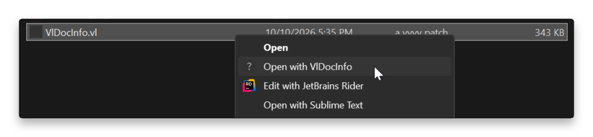
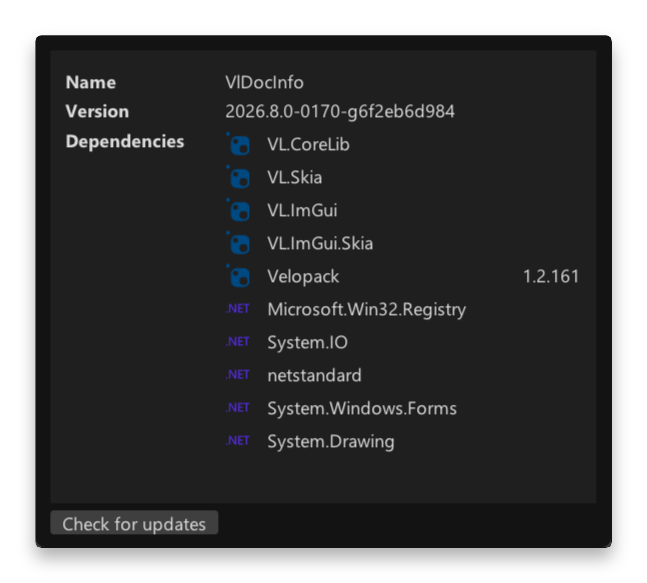

# VlDocInfo

 

Get information about your VL documents without opening them!

	

This app adds an explorer context menu entry for VL documents and lets you see information about your document at a glance.

## Installation

Go to this repository's [Releases](https://github.com/sebescudie/VlDocInfo/releases/latest) section and either download the installer or the portable version. The app features an auto-updater, so you'll be notified when a new version is available.

## Features

The app will show the following information

- Version the document was last saved with
- Dependencies 

	

## Next up

- Show if a dependency is forwarded
- Definitions
- Categories hierarchy
- Count nodes, pads and links, just for "fun"
- Check if DocumentDependency elements resolve irl
- Is the referenced vvvv version installed?
- Is editor extension?